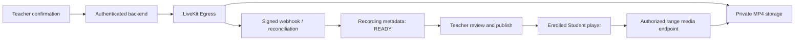

# ONLINE CLASS RECORDING

ProctoOwl records the existing LiveKit classroom through a trusted server-side Egress worker. Recording is off for every class until its authorized host confirms **Bắt đầu ghi**. Creating or joining a class never starts recording.

## Architecture and provider audit

The existing provider is a self-hosted LiveKit SFU. The Python server SDK supports the current `StartEgress` API with a room template source. This implementation uses the standard **speaker** composition, mixed participant audio, published camera tracks and screen sharing. It records the provider template rather than the ProctoOwl application page, so AI Support, private messages and application navigation are not captured.

The output is H.264/AAC MP4, 1280×720, with a default recording frame rate of 15 fps for the local PBL setup. `RECORDING_FRAMERATE` can be set from 5 to 30. The meeting itself retains its existing video settings. The provider controls screen-share composition; this does not promise an exact recording of the custom meeting canvas.

Sources: [LiveKit Egress deployment](https://docs.livekit.io/transport/self-hosting/egress/), [composite layouts](https://docs.livekit.io/transport/media/ingress-egress/egress/composite-recording/), [Egress Python SDK](https://docs.livekit.io/reference/python/livekit/api/egress_service.html).

## Lifecycle

Recording state is separate from the Live Class lifecycle:

`NOT_STARTED` (no row) → `STARTING` → `RECORDING` → `PROCESSING` → `READY` → `PUBLISHED` ↔ `UNPUBLISHED` → `DELETED`.

Provider or storage failure leads to `FAILED`; no file becomes `READY` merely because the Teacher pressed Stop. A successful provider completion must match the server-generated output reference, report positive duration/size, and have a matching private MP4 file. The application never generates a substitute completed recording.

Start persists its intent before calling Egress. A lost provider response remains `STARTING` until reconciliation finds the matching provider job or confirms that no job was created. A partial unique index prevents simultaneous active recordings for a class. Stop is idempotent and persists a retryable stop request before making the provider call.

Ending a class requests recording stop before deleting the room. A confirmed room closure transitions the acknowledged recording to `PROCESSING`; Egress completion still owns final readiness. The existing durable classroom worker retries missed stops/closures and reconciles signed Egress events. Teacher disconnect does not call Stop. Like the provider's room-template recordings, a segment may finalize if all meeting participants leave; a new recording creates a separate segment rather than overwriting it.

`RECORDING_PROCESSING_TIMEOUT_SECONDS` defaults to 1800 (30 minutes). A stopped segment still lacking a completed provider result after that bound becomes `FAILED / PROCESSING_TIMEOUT`, including during a provider outage. It cannot be played or published, and the host can delete it. A valid completed result is applied before evaluating this timeout. Recording row-lock acquisition and commits run outside the async event loop, so an overlapping webhook cannot freeze unrelated API requests while waiting for a transaction to close.

## Teacher and Student experience

- Host-only start confirmation explains that audio, video and shared screen content may be stored. The meeting bar offers Start/Stop; there is no unsupported Pause button.
- All participants receive a persistent red indicator and elapsed time. A one-time notice announces recording. Late joiners see a notice before admission/join and the indicator after entering. Waiting-room preview tracks are not published into the recorded room.
- Ended class details have a **Bản ghi buổi học** section. Processing/failure has status text rather than a broken player. Teachers can preview ready files, explicitly publish, unpublish or confirm deletion.
- Publishing sends the existing classroom notification only to current enrolled Students. Provider completion alone does not notify Students or publish a file.
- Student lists show **Bản ghi có sẵn** and a real playback link only when a published, unexpired recording exists. Other ended sessions retain their detail link.
- Playback is inside the existing role-based application shell. Native HTML5 controls provide play/pause, seek, volume, mute, time/duration and fullscreen; the speed selector offers 0.75x, 1x, 1.25x, 1.5x and 2x. Position is stored locally per user/recording. No viewing-analytics tables were added.

## Authorization and private media

Backend checks reuse the existing Teacher ownership, Admin permission and Student enrollment rules. Students cannot list or open unpublished recordings. Recording start also requires a live class. Provider identifiers, filesystem paths and storage keys are never serialized to the browser.

The frontend exchanges its normal per-tab authentication for a five-minute playback ticket. The media endpoint verifies that ticket and rechecks the current user, enrollment, publication state, expiry and access version for each HTTP request and stream chunk. Unpublish, delete and expiry revoke access independently of an old ticket. The player also checks access while open and clears its source on revocation. Playback tickets are stripped from media access-log query strings. Metadata and media responses use `private, no-store`.

Media lives in `backend/private/recordings`, already covered by the repository's `backend/private/` ignore rule. It is never mounted as public static content or stored in PostgreSQL. `RecordingStorage` provides the private-storage boundary; the implemented driver is a local filesystem shared with the self-hosted Egress worker. Cloud/object storage is not configured by this PBL driver.

There is no Student download action or download endpoint. The native player uses `controlsList="nodownload noremoteplayback"`. This is not DRM: an authorized viewer's browser necessarily receives playable media bytes.

## Retention, deletion and audit

`RECORDING_RETENTION_DAYS` defaults to 30. Each recording has an expiry timestamp. Access is denied at expiry, and the durable backend worker removes expired files. Failed physical deletion remains queued for retry after access is revoked. Existing class-deletion cascades are retained; the worker also removes private orphan files after a finalization grace period.

The existing audit table stores `RECORDING_STARTED`, `RECORDING_STOPPED`, `RECORDING_PUBLISHED`, `RECORDING_UNPUBLISHED` and `RECORDING_DELETED`, with actor, recording/class identifiers and timestamp. Video content and provider credentials are not logged.

## Local setup

1. Apply migration `0025_class_recordings`: from `backend`, run `.venv\Scripts\python.exe -m alembic upgrade head`.
2. Start the existing local classroom SFU, then run `scripts/start-classroom-recording.ps1`. This explicit setup checks that no participants are connected before restarting the local SFU with Redis. It generates credentials only in ignored private configuration.
3. Keep Docker and the application services running. The helper starts `redis:7.4-alpine` and `livekit/egress:v1.15.0` using [recording.compose.yaml](../infra/livekit/recording.compose.yaml). The local worker is limited to six CPUs.
4. Restart FastAPI after setup so it reads the recording capability and worker health configuration.

Once local recording is configured, `npm run dev` checks that Redis responds before starting LiveKit. If `LIVEKIT_REDIS_ADDRESS` is `127.0.0.1:6382` or `localhost:6382` and Redis is unavailable, it starts only the Compose `redis` service and waits for readiness. Docker Desktop must be running. If Docker is unavailable, the diagnostic gives the recovery command: `docker compose -f infra/livekit/recording.compose.yaml up -d redis`, then retry `npm run dev`. Other Redis addresses must be started separately. `-ConfigureOnly` does not start Redis or LiveKit.

The local helper retains internal ICE candidates alongside the LAN mapping when Redis/Egress is configured. This lets the Docker worker reach the native Windows SFU through its WSL interface. A successful WebSocket connection alone does not establish a recording media connection.

Configuration defaults are in [backend/.env.example](../backend/.env.example). `CLASS_RECORDING_ENABLED=false` disables capability by default. Enabling capability or starting the worker still does not record any class automatically. When the worker is unavailable, the host sees **Ghi hình hiện không khả dụng.**

Local Egress is resource-intensive; LiveKit recommends at least four CPUs and 4 GB for a worker. Production should use appropriately sized recording infrastructure and private shared storage. This Windows PBL helper is for the existing local SFU; it does not provision a cloud storage backend or a production recording cluster.

## API

| Method | Route | Access |
| --- | --- | --- |
| POST | `/live-classes/{id}/recording/start` | Authorized host; live class |
| POST | `/live-classes/{id}/recording/stop` | Authorized host; idempotent |
| GET | `/live-classes/{id}/recordings` | Host sees metadata; enrolled Student sees published records |
| GET | `/recordings/{id}` | Host or authorized published-recording viewer |
| POST | `/recordings/{id}/publish` | Authorized host; ready private file required |
| POST | `/recordings/{id}/unpublish` | Authorized host; revokes existing tickets |
| DELETE | `/recordings/{id}` | Authorized host; confirmed by UI |
| GET | `/recordings/{id}/playback` | Authenticated review/view authorization |
| GET | `/recordings/{id}/media?ticket=…` | Short-lived ticket plus current authorization; range streaming |

All routes use the existing `/api/v1` prefix.

## Validation

- Backend: **54 distinct tests passed** (23 recording cases and 31 existing classroom cases), plus a focused PostgreSQL row-lock regression using two independent connections.
- Monitoring page follow-up: **6 existing tests passed**, including 375/768/1440px layout, filtering and pagination after removing the requested overview cards/chart.
- Production build and two actual server-side recording/playback scenarios passed, including a final 2.7-minute provider run after the row-lock fix. The final local fixture uses listen-only Students to reduce contention on the shared 8GB machine; the Teacher still publishes actual audio/video and screen share. Existing real classroom cases were verified across regression runs, including a targeted host-removal case with a deliberately lost HTTP response. Full evidence and limitations: [recording verification report](online-class-recording-report.md).

No Face Verification, exam scoring, question generation, Student Card OCR or AI Support business logic was changed by recording. The separate Teacher monitoring requests remove the overview KPI/chart block and repair the exam-specific report/review flow; see [its report](proctoring-report-fix.md).
