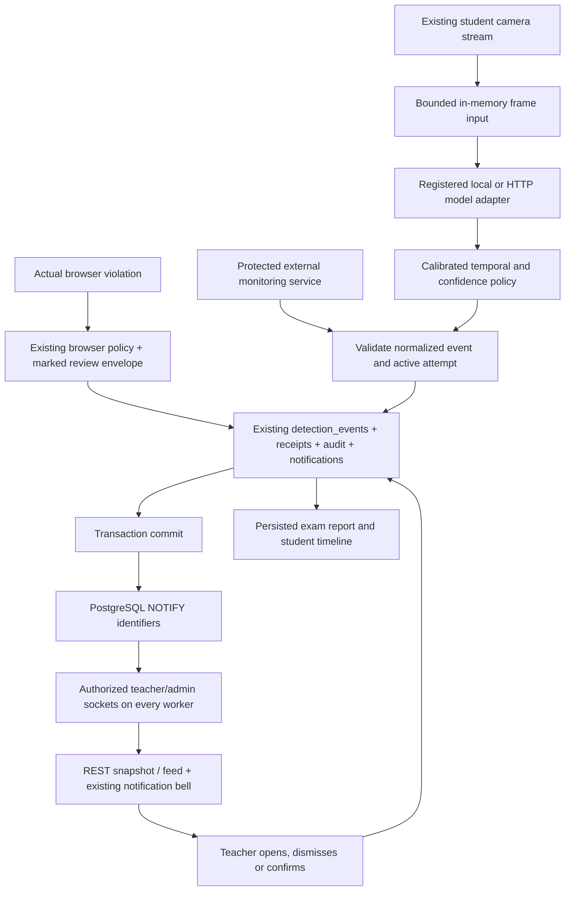

# ProctoOwl proctoring alerts

## Shipped behavior

In-exam monitoring now uses a model-independent, persisted review queue. No trained monitoring model ships with this change. With the default configuration, the UI says **“Chưa kết nối module AI giám sát.”** and produces no AI detections. Actual browser signals remain explicitly self-reported. DEV simulator events have source `TEST_SIMULATOR`, a visible **Mô phỏng** label, separate feed/report queries, and prefixed notifications.

Pre-exam identity verification remains separate: YuNet, SFace, 128-dimensional embeddings, cosine matching and `FACE_MATCH_THRESHOLD=0.363` are unchanged. Alert ingestion, aggregation and review never grade, terminate an attempt, or update a risk score. The existing browser violation policy and its established counters/lock behavior remain intact. New browser review envelopes are excluded from that legacy calculation so a browser signal is not counted twice.

## Audit and reuse

The project already had `proctoring_sessions`, `detection_events`, browser `violation_logs`, `audit_logs`, notifications, private media routes and an exam-scoped WebSocket connection manager. The old detection endpoint accepted student-provided AI severity and updated legacy risk. It is now denied; authoritative detections use the protected backend boundary. Existing exam/session/attempt entities are reused.

Migration `0023_proctor_alerts` extends `detection_events`; it does not create a competing alerts table. `event_type` changes from a closed database enum to a validated string. Legacy rows keep their IDs, confidences, timestamps, evidence references and attempt links, are marked `LEGACY`, and are backfilled with exam/student links. Existing legacy reports retain their original detection counts; the new review report is separate.

## Architecture



WebSocket messages contain identifiers, scope and simulation flags. Event details are retrieved through authorized REST endpoints. PostgreSQL `NOTIFY` participates in the database transaction: a rolled-back alert is never published. A listener reconnect sends `resync`; the UI reloads persisted data. Notification delivery is an invalidation mechanism, not an event store, so reconnects do not depend on replaying missed packets.

## Data and lifecycle

`DetectionEvent` adds exam/student links, source/provider, safe message and metadata evidence, reception/first/last timestamps, duration, occurrence count, maximum confidence, simulation flag, review status/actor/time/note and optimistic `review_version`. Confidence is nullable and constrained to `[0,1]`. Unknown confidence is never replaced with a guessed percentage.

`ProctorEventReceipt` keys meaningful emissions by `(attempt_id, provider, external_id)` for exact retry handling. The attempt row is locked while ingesting, so concurrent workers cannot create duplicate alerts for the same retry or cooldown interval. Separate emissions for the same attempt/provider/source/type extend the existing cooldown event. Aggregation keeps the reviewer’s decision and does not generate another notification or toast. Receipts are not frame logs.

Human lifecycle:

| Status | Meaning |
| --- | --- |
| `NEW` | Not opened or decided |
| `REVIEWED` | Teacher opened and acknowledged |
| `DISMISSED` | Teacher dismissed the signal |
| `CONFIRMED` | Teacher confirmed that it is relevant |

GET requests never acknowledge events. Opening the UI explicitly PATCHes `REVIEWED`. A teacher may dismiss/confirm directly or amend a previous decision; every changed decision records actor, timestamp, prior/new status and optional note in `audit_logs`. A stale `expected_version` receives `409`; refresh before retrying. Aggregation does not increment the human review version. Confirming is a review decision, not automatic disciplinary action.

Indexes reuse attempt/time and session indexes and add exam/simulation/time plus exam/simulation/status/severity for feed and review summaries. Alembic is the migration authority; root `schema.sql` is the original bootstrap used by the initial migration, not a replacement for upgrading an existing database.

## Endpoints

All routes below start with `/api/v1/proctoring`.

| Method / path | Authorization / purpose |
| --- | --- |
| `POST /events` | Server-only `X-Proctor-Service-Key`; normalized model events |
| `POST /modules/{provider}/heartbeat` | Same protected credential; safe module health |
| `GET /exams/{id}/events` | Owning teacher/admin; filters and real operational counts |
| `GET /exams/{id}/health` | Owning teacher/admin; safe module availability |
| `GET /events/{id}` | Owning teacher/admin; event, exam and review history |
| `GET /events/{id}/evidence` | Owning teacher/admin; existing private legacy snapshot only |
| `PATCH /events/{id}/review` | Owning teacher/admin; versioned human decision |
| `GET /exams/{id}/report` | Owning teacher/admin; persisted status/type/student summary |
| `GET /attempts/{id}/timeline` | Owning teacher/admin; real start/event/review/submit chronology |
| `GET /sessions/{attempt}/input-capabilities` | Active attempt owner only; enabled transport/cadence, no detections |
| `POST /sessions/{attempt}/frame` | Active attempt owner, enabled camera session and configured model |
| `DELETE /sessions/{attempt}/input` | Attempt owner; close local inference resources |
| `POST /dev/simulate` | Double DEV guard plus owning teacher/admin |
| `WS /ws` | Authenticated teacher/admin global invalidations |

The existing `WS /api/v1/ws/monitor/{exam_id}` remains, with the same backend ownership checks. Both sockets require an initial `{"type":"auth","token":"<access JWT>"}` frame; JWTs are never put in URLs. The initial frame is bounded/timed, allowed origins are checked, and heartbeat checks revalidate token expiration, account state and scoped access. Refresh tokens are rejected. Students cannot subscribe. Per-tab access tokens take precedence over a shared browser cookie.

Event filters: `status`, `priority`, `event_type`, `attempt_id`, `q`, `page`, `limit`, `order`, `simulated`. Lists default to real events; `simulated=true` is an explicit separate query. Page size is capped at 100. Timeline rendering is bounded to the latest 100 events and 200 review entries, with a truncation notice and feed search for older events. Report event totals count aggregated alerts, not raw frame predictions.

## Teacher experience

The monitoring page shows actual exam timing, connection state, student/taking/submitted counts, new events and high-severity events. The session list retains camera access through the existing call panel and existing private recordings. Feed filters, source details, nullable confidence, duration, evidence summary, review notes and actor history operate on persisted data. No new risk/cheating/integrity score is presented.

Only a live `proctor_event_created` for a high/critical, still-new event in the current exam and real/simulated scope triggers a toast. Updates, retries, aggregation and reconnect snapshots do not. Toasts close after eight seconds and have keyboard-accessible actions. Medium/high/critical creates add one notification per authorized recipient through the existing notifications table/bell. Clicking includes exam, attempt, event and simulation scope. Review marks that reviewer’s corresponding notification read.

On mobile the feed precedes the collapsible session list. Shared accessible modals contain event details and timelines. ProctoOwl teal and existing semantic light/dark tokens are reused; only the empty feed has a small mascot. The existing sidebar remains independent of main-page scrolling.

WebSockets drive event refresh. Disconnected pages fall back to a visible-only 15-second snapshot, plus manual/focus refresh. Health is rechecked every 30 seconds to expose expired module heartbeats even when no event arrives; this is not frame or alert polling. Global notifications retain their existing refresh behavior for other notification types.

## Failure and performance boundaries

- Normalized JSON is limited to 16 KiB before parsing. Frame multipart input is bounded before spooling, the image to 1 MiB and two million pixels, and inference responses to 16 KiB / 32 predictions. New evidence accepts only allowlisted metadata/bounding boxes.
- One frame per student attempt and at most 32 active frame operations per API worker; no unbounded queue. Warm adapters are bounded to 128 records per worker, cleaned after 120 seconds idle, closed on stop/eviction/shutdown, and protected against resurrection when a stop races an in-flight operation.
- Meaningful event receipts are limited per attempt per minute (`120` by default, configurable). Duplicates bypass this limit without changing counts. Minimum durations/confidence/cooldown come from model configuration; all required temporal values default to uncalibrated/disabled.
- Camera sampling uses the shared stream, canvas and one in-flight request. No frame enters React state, no per-frame rendering occurs, and no additional camera is opened. Cadence comes from calibrated backend configuration. Disabled models cause no sampling. Inference failures back off without interrupting existing exam completion/device policy.
- Slow/crashed/invalid adapters yield `DEGRADED`/`UNAVAILABLE` with safe codes, release resources, and emit no fallback detections. Submitted/ended/inactive attempts reject later events; activity is checked again after inference.
- Synchronous database transactions run in worker threads. A row-lock wait during ingestion/review cannot block the asyncio loop needed to finish another response, release its session or deliver WebSockets. In particular, the existing attempts list briefly locks rows while checking expiry; this does not deadlock concurrent normalized intake. Grading/finalization rules remain unchanged.
- `ProctorModelHealth` is persisted across workers. Missing/expired health is `UNAVAILABLE`, configured off is `DISABLED`, successful real processing/heartbeat can be `ACTIVE`. Teacher responses hide operational error codes; admins can inspect safe codes, calibration and last-seen time. These states describe transport/module operation, not detection accuracy.

Local temporal state is per worker. For local/HTTP frame adapters deploy sticky routing by attempt (or one frame worker); alternatively run temporal inference in a dedicated service and use protected normalized ingestion. Database aggregation, retry handling, reviews, health and WebSocket delivery work across API workers. Temporal state resets on restart/reassignment and may delay an alert until a fresh continuous observation; it never invents continuity.

## Evidence and privacy

New alert evidence is metadata-only. Frames are processed in memory and discarded; no new snapshots, recordings, raw audio, embeddings, frame histories or public URLs are accepted. The established exam recording feature is unchanged and remains behind existing authenticated media routes. Existing legacy snapshot references are retained by migration, not copied into new events. The detail panel can fetch a retained legacy snapshot through an owner/admin-only, no-store endpoint; it never exposes an arbitrary storage URL, and missing/deleted evidence is handled calmly. Do not log frame bodies, inference request bodies, JWTs, service keys or model internals.

Alert records, receipts and audit history follow the existing exam/attempt database lifecycle and backup/access policy. This change adds no arbitrary time-based deletion of review history. Before adding stored snapshots/audio, the product must define consent, access, expiry/deletion and backup retention; use private storage and an authorized endpoint. No evidence retention assumption is hidden in an adapter.

## Configuration and DEV simulator

Defaults in `backend/.env.example` disable models and the simulator, leave the ingest secret empty (endpoint rejects all), and contain no frontend secret. Restart workers after configuration/registration changes.

To exercise transport without a trained model, use an isolated development/test database and set **both** `ENVIRONMENT=development` (or `test`) and `PROCTOR_SIMULATOR_ENABLED=true` on the backend. Production/prod/other environments refuse simulator-enabled configuration, and the route independently checks both guards. Authenticate as the exam-owning teacher/admin, select an active attempt, then:

```text
POST /api/v1/proctoring/dev/simulate
Authorization: Bearer <teacher access token>
{"attempt_id":"<active test attempt UUID>","event_type":"multiple_faces","external_id":"<retry UUID>"}
```

`gaze_away` is the only other simulator type. No confidence is supplied. The simulator’s short cooldown is explicitly test transport behavior, never production calibration. `backend/scripts/simulate_proctor_event.py` calls this endpoint using `PROCTOR_SIMULATOR_TOKEN` from the process environment; do not paste tokens into shell history or URLs. Turn the flag off/restart after testing. Simulated records remain visibly segregated in history; they do not turn into real events when the flag is off.

## Migration and verification

Run `python -m alembic upgrade head` from `backend` before deploying this backend. Migration `0023_proctor_alerts` preserves legacy data; invalid historical out-of-range confidence fails the migration explicitly instead of silently rewriting it. Downgrade refuses while normalized alerts exist to prevent losing review data. PostgreSQL's unused added `info` enum value remains after a downgrade.

Verification commands:

```text
python -m unittest tests.test_proctor_alerts tests.test_proctor_adapters tests.test_teacher_reports tests.test_teacher_results -q
npx tsc --noEmit
npm run build
```

Isolated live QA uses `backend/scripts/release_qa_runtime.py`, `proctoring_e2e_fixture.py`, and explicit `PROCTOR_LIVE_QA=1` Playwright tests. Private generated tokens stay under ignored `backend/private/release-qa`. `verify_proctor_migration.py` only permits the named isolated QA database and runs before normalized test events are seeded. Do not run its downgrade/upgrade check against an application database.

The live test covers simulator → validation → persistence → committed multi-worker WebSocket → count/feed/toast → acknowledgment → dismissal/confirmation → refresh → report, exact concurrent retries, authorization, bell deep links, no-model emptiness and 1440/1024/390 layouts. `tests.test_proctor_postgres` additionally verifies commit-only NOTIFY and rollback, status invalidations and unchanged attempt scores/counters in the isolated QA database (`PROCTOR_POSTGRES_TESTS=1`). It is a transport/review test, not a claim of trained model accuracy. See the change inventory and test results in [the implementation report](proctoring-implementation-report.md).
